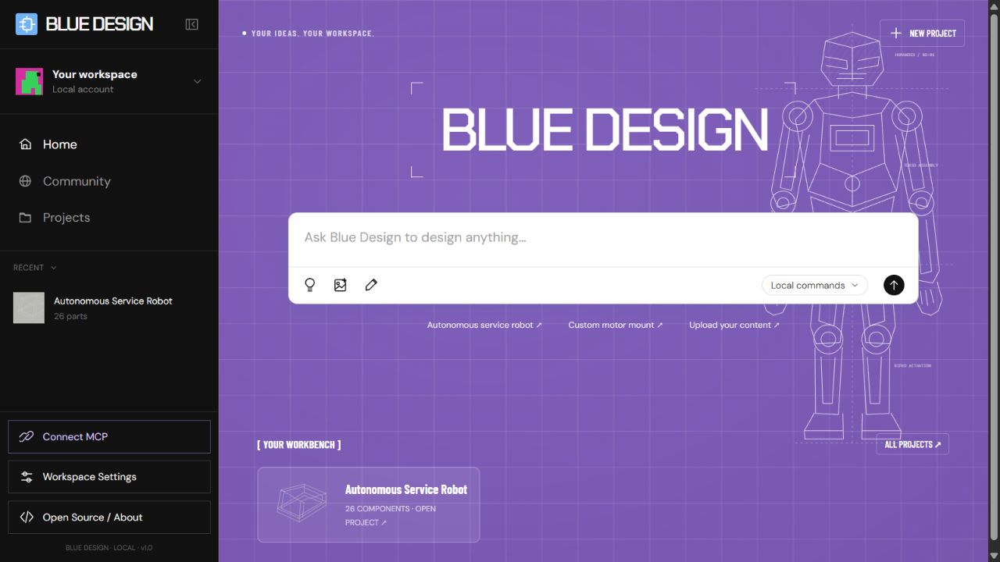
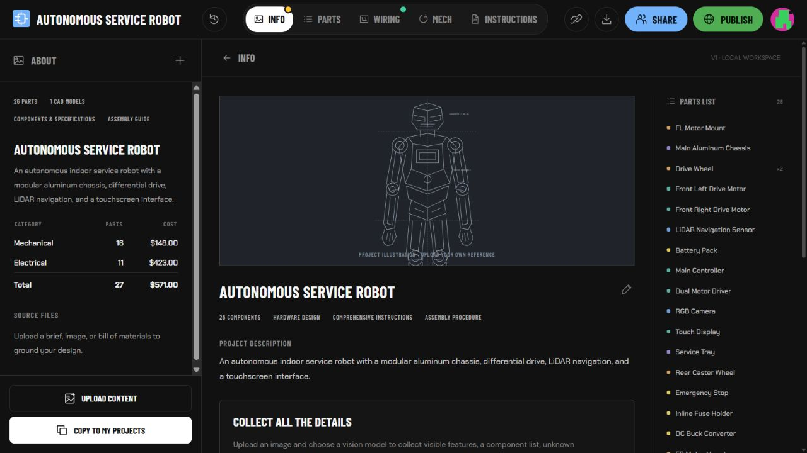
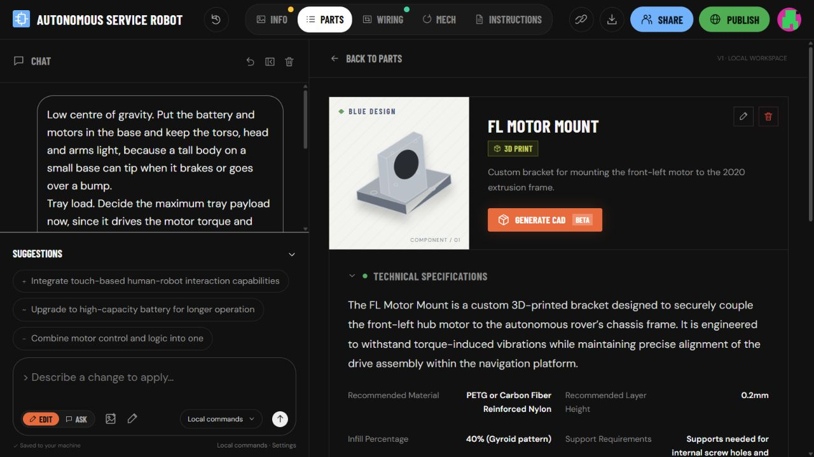
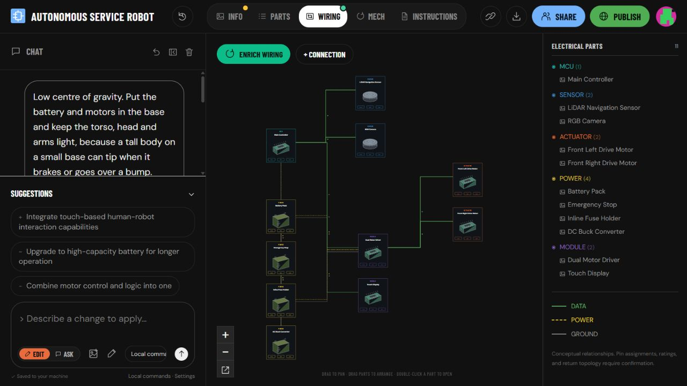
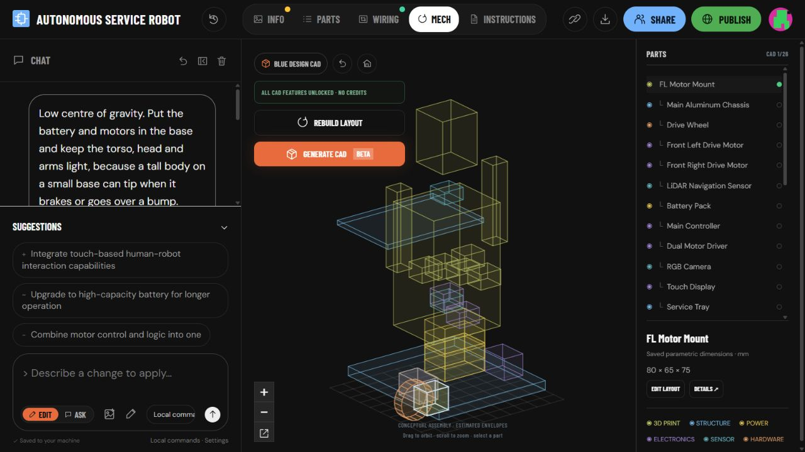
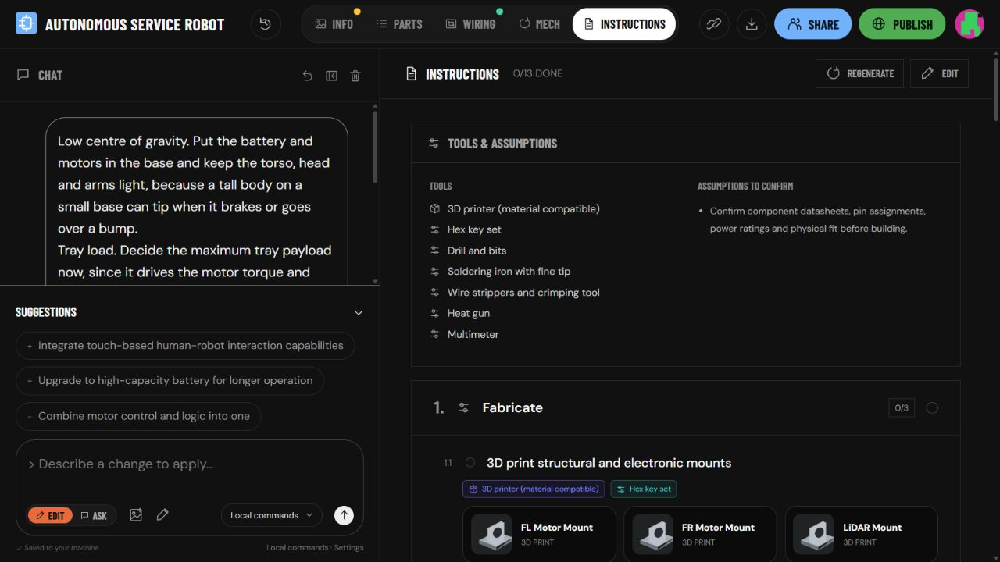
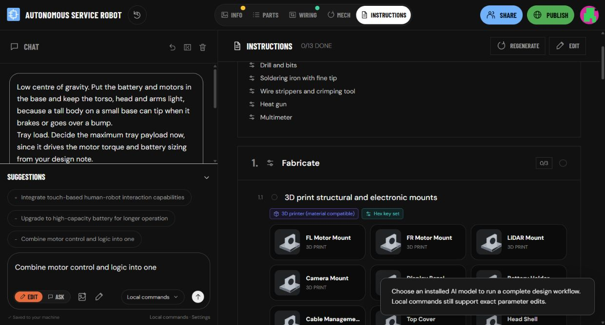
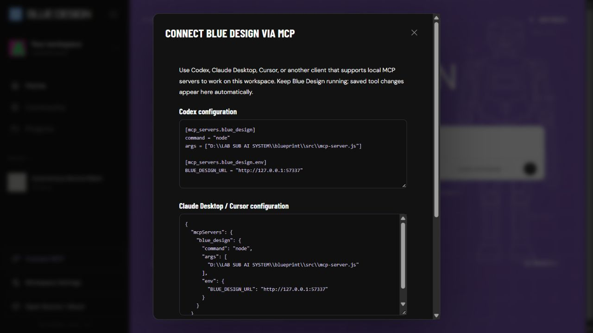
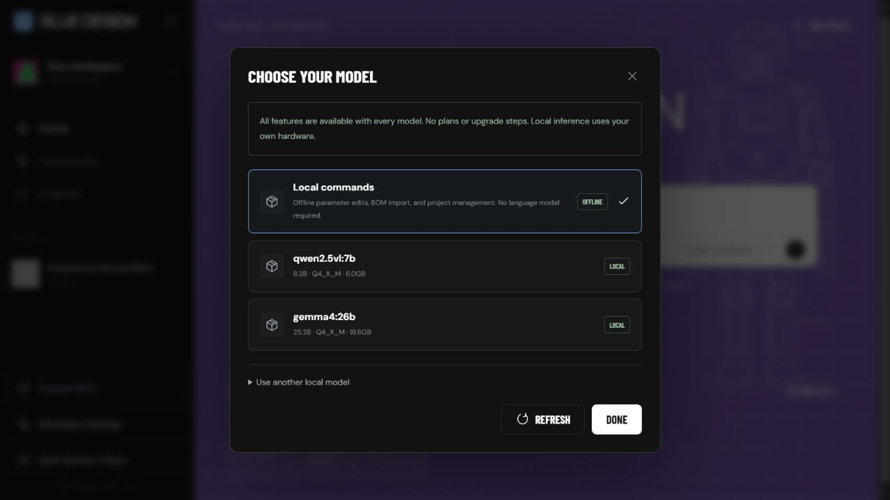

# Blue Design

An open-source hardware design workspace for turning a reference image or an idea into a connected project: **Info → Parts → Wiring → Mech → Instructions**.

Work with an installed local model, your configured provider, or a desktop AI client connected through MCP. Blue Design keeps the project, diagrams, assembly layout and build checklist together.



[Get started](#how-to-run) · [Screenshots](#screenshots) · [MCP connection](#connect-your-ai-client-with-mcp) · [Future updates](#future-updates) · [Contributing](CONTRIBUTING.md)

## What works today

- **Project workspace:** create, duplicate, import and export projects; keep local history and component specifications.
- **Content collection:** upload images, PDFs, text, Markdown and CSV BOMs. A selected vision model can collect visible features, inferred components, unknown specifications and follow-up questions.
- **Design workflow:** use **Edit** to apply a validated plan across the brief, components, wiring, conceptual mechanical layout and linked instructions. **Ask** answers questions without changing the design.
- **Parts and BOM:** quantities, costs, categories, materials, notes, connections and CSV export.
- **Wiring:** draggable nodes; data, power and ground connections; zoom, visibility filters and saved positions.
- **Mechanical workspace:** orbitable component envelopes, layout editing and SCAD export, plus a supported parametric bracket with OpenSCAD/STL export.
- **Build guide:** Fabricate, Wire, Bring-up and Assemble sections with tools, component cards and saved completion progress.
- **MCP workflow:** a connected client can read the actual project and apply its own plan. Saved changes appear automatically in the frontend.
- **Model switching:** discover installed Ollama models or use your configured OpenAI account.
- **Sharing:** local read-only snapshots that exclude private conversations and original source files.

There are no application plans, subscriptions, credits or premium feature gates. Local models use your own hardware. External providers may charge your own account; model weights are installed separately.

## How to run

Requires **Node.js 22 or later**. No npm dependencies or build step are required.

```powershell
git clone https://github.com/madanop772-max/BLUE-DESIGN.git
cd BLUE-DESIGN
npm start
```

Open **http://127.0.0.1:5180**. On Windows, you can also double-click `start.cmd`.

Start with the included service-robot template or create a blank project. For AI-backed workflows, select an installed model or configure a provider below. Exact rename and bracket-parameter commands work in **Local commands** mode.

### Example workflow

1. Upload a robot image, design brief or component list.
2. Choose a vision-capable model and click **Collect all the details**, or include the uploaded image in an **Edit** request.
3. Describe the change, such as “Integrate touch interaction using the display and controller.”
4. Review the saved changes in **Info**, **Parts**, **Wiring**, **Mech** and **Instructions**.
5. Refine dimensions and confirmed connections, export supported files, and track the build checklist.

Invalid plans and stale project versions are rejected before saving a partial design.

## Screenshots

These screenshots were captured from an isolated sample workspace, without personal uploads or private project conversations. The template demonstrates the interface; its component specifications and costs are examples.

### Project overview

The overview brings the design description, component list, reference illustration and cost summary together.



### Parts and specifications

Open a component to inspect its specifications, relationships, materials and supported CAD files.



### Wiring

Arrange electrical components and inspect their typed connections.



### Mechanical layout

Orbit and edit the conceptual assembly, toggle components and export the envelope layout.



### Build instructions

Follow the Fabricate, Wire, Bring-up and Assemble checklist with linked tools and component cards.



### Assemble

Component cards connect each assembly task to the parts involved. Future video guidance will build on this section.



### MCP connection

The app generates configuration examples for the local installation.



### Choose your model

Available local models depend on what is installed on the computer. The screenshot shows an example installation, not bundled model weights.



## Configure local AI

Install Ollama and a model separately. Select the installed model in the UI, or copy `.env.example` to `.env` and configure:

```env
AI_PROVIDER=ollama
OLLAMA_URL=http://127.0.0.1:11434
OLLAMA_MODEL=your-installed-model
```

Image collection requires a model that supports image input. Local inference does not require a provider API key. Image generation is a **future feature**, distinct from the image-understanding workflow available today.

For your own OpenAI account:

```env
AI_PROVIDER=openai
OPENAI_API_KEY=your-key
OPENAI_MODEL=your-supported-model
```

Restart the server after editing `.env`. Provider-backed Edit requests send project context and attached source images to the selected provider. Use local models when you want that processing to remain on your machine. Local PDF interpretation is not implemented; upload page images to use a local vision model.

## Connect your AI client with MCP

Keep Blue Design running and open **Connect MCP** in the sidebar or editor. Copy the configuration for your client, then reconnect it.

A local stdio configuration for clients that support this format:

```json
{
  "mcpServers": {
    "blue_design": {
      "command": "node",
      "args": ["/absolute/path/to/BLUE-DESIGN/src/mcp-server.js"],
      "env": { "BLUE_DESIGN_URL": "http://127.0.0.1:5180" }
    }
  }
}
```

Codex uses the same command and arguments under `[mcp_servers.blue_design]`, with the URL under `[mcp_servers.blue_design.env]`. Use `node` directly as the client command: npm may write banners to stdout, while MCP stdio requires protocol messages there.

The normal tool sequence is:

```text
blue_design_list_projects
  → blue_design_get_project
  → blue_design_apply_workflow
  → frontend displays the saved project
```

The connected client's own model supplies the plan; Blue Design does not need to call a second model. `blue_design_run_workflow` can instead delegate planning to the model selected inside the app. Read-only assembly and wiring tools expose the saved project layouts.

The frontend checks for saved revisions every 2.5 seconds. Unsent text, open forms and active drags postpone refreshes. Hosted clients need a supported remote connector or tunnel; a cloud service cannot reach this computer by using its own `localhost` address.

Blender and SolidWorks use separate MCP integrations. A client can work with those tools alongside Blue Design when installed and authorized; Blue Design does not execute arbitrary Blender scripts. Optional Millwright connection settings are documented in `.env.example`.

## Future updates

The items below are a roadmap, **not features included in this release**. We will update this README as they become available.

| Planned feature | Intended experience |
| --- | --- |
| Component assembly videos | Open a component under **Assemble**, choose a future **How it runs** guide, and watch the mounting and connection sequence. |
| End-to-end example videos | Follow a complete example from uploaded content through parts, wiring, mechanical layout, assembly and operation. |
| AI-generated backgrounds | Generate and choose project-specific background artwork, including humanoid-robot themes. |
| Local AI image generation | Connect a separately installed local image-generation runtime, generate reference images or component illustrations, and save them into the project. |
| Richer model and CAD integrations | Improve client-driven workflows and expand supported editable geometry and external-tool handoffs. |

### Planned “How it runs” example

For an **FL Motor Mount** component, a future video guide could show the component orientation, fasteners, mounting sequence and alignment checks. A companion operation example could show the assembled drive system during bring-up. For a touch interface, the guide could demonstrate touch, release, reconnect and response behavior.

Generated illustrations and videos will be labeled as explanatory media. Actual component dimensions and verified connections will remain part of the project data.

## Project scope and local data

This README describes **Blue Design only**. It does not change rules or behavior in sibling applications. Original application code is MIT-licensed; separately installed models and external tools retain their own licenses. This is an independent implementation, not affiliated with Blueprint.io, and does not include that service's proprietary code or assets.

Projects and uploads live in `data/`. Back up that folder, and keep it and `.env` out of Git. The release excludes personal uploads, API keys and workspace databases. The server is designed for a single user on loopback; public multi-user hosting needs a separate authentication and deployment design.

Mechanical envelopes are estimates unless a supported parametric model supplies dimensions. AI-proposed wiring pins remain TBD until confirmed. Review actual datasheets, fit and loads before fabrication.

## Development

```powershell
npm run check
npm test
```

The test suite covers local sessions, file uploads, persistence, version conflicts, CAD exports, source parsing, atomic design workflows and the real MCP subprocess. Tests use isolated temporary projects.

| Folder | Purpose |
| --- | --- |
| `src/` | HTTP API, persistence, model workflows, CAD exports and MCP server |
| `public/` | Frontend, diagrams, viewers and original SVG artwork |
| `test/` | Regression and integration tests |
| `docs/screenshots/` | README gallery |
| `examples/` | Import examples |

See [API documentation](docs/API.md), [contributing guidance](CONTRIBUTING.md) and the [MIT license](LICENSE).
